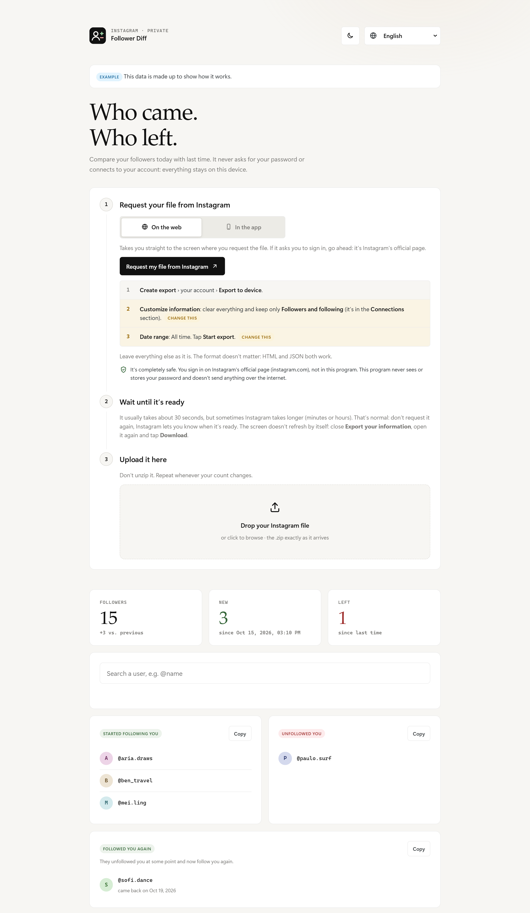
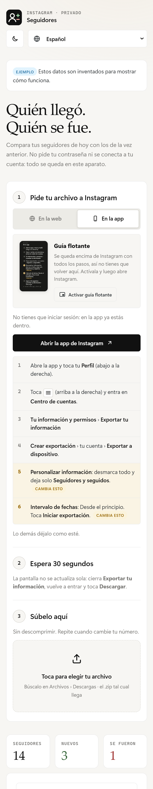
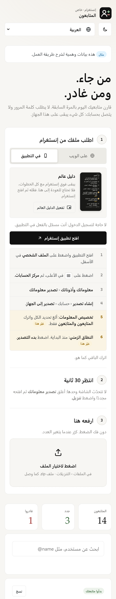
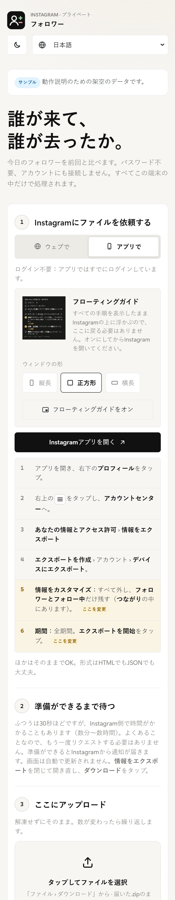

<h1 align="center">Follower Diff</h1>

<b>See who followed and who unfollowed you on Instagram.</b> 
Private, free, and safe for your account. No login, no password, no bots.

<a href="https://samutecyt.github.io/follower-diff/"><b>Open the app</b></a> · <a href="https://github.com/SamuTecYT/follower-diff/releases/latest/download/Follower-Diff.html"><b>Download for PC / Mac</b></a> · <a href="https://samutecyt.github.io/follower-diff/#demo">Try it with example data</a>

  <a href="#español">Español</a> · <a href="#english">English</a>

  
  
  

All screenshots use made-up example data.

---

## English

### Get it
**On a computer (Windows or Mac):**
1. Click **[Download Follower Diff](https://github.com/SamuTecYT/follower-diff/releases/latest/download/Follower-Diff.html)**. You get one file: `Follower-Diff.html`.
2. Double-click it. It opens in your browser and works **without internet**.
3. Optional: drag the file to your desktop so it's always at hand.

**On a phone (iPhone or Android):** open **[the app](https://samutecyt.github.io/follower-diff/)** in Safari or Chrome, tap **Share › Add to Home Screen**. It gets its own icon, like an app.

### Optional account
Protect your history with a password. No server: everything stays encrypted on your device. 100% optional.

- **Create it:** tap **Create account**, type a nickname and a password. Done.
- **Use it on another device (3 steps):**
  1. Tap **Move to another device**. You get `follower-account.json`.
  2. Send it to yourself (WhatsApp, email, AirDrop or Drive). It's encrypted.
  3. On the other device tap **I have an account**, choose the file and type your password.
- Devices don't sync by themselves: after adding a new Instagram file, repeat the 3 steps.
- If you forget the password it can't be recovered, because no one else has it.

### What it does
Instagram lets you download your own data, including your list of followers. Follower Diff takes that file and compares it with the previous one, so you can see:

- **Who started following you** since last time
- **Who unfollowed you** since last time
- **Who you follow that doesn't follow you back**
- **Who follows you that you don't follow back**
- **Mutual follows**: everyone you follow who also follows you
- **Search any user** to see at once if you follow each other, only one way, or not at all. All lists filter as you type
- Built for **big accounts**: tested with 100,000 followers. Long lists load in pages, so the app stays fast
- Tap a name to open the profile: **in the Instagram app** on phones, in your default browser on computers
- **Copy any list** with one tap
- **Dark mode** that follows your device
- A **history** of every snapshot, with follower counts and dates

### Why it can't get you banned
It uses only Instagram's official **Download your information** feature. The app never logs into your account, never asks for your password, and doesn't automate anything on Instagram.

### Privacy and security
- **Nothing leaves your device.** The page has a strict Content Security Policy that blocks every network connection, so your followers can't be sent anywhere.
- **No accounts, no servers, no tracking, no cookies, no analytics.**
- Usernames read from the file are checked against Instagram's username rules before they are shown. A tampered file can't inject code.
- History is stored only in your browser. You can save a backup and load it later.
- A single, readable HTML file with no dependencies. You can audit all of it.

### How to use
1. Open **https://samutecyt.github.io/follower-diff/** (or download `index.html`) in any modern browser, on a computer or a phone.
2. Tap **Request my file from Instagram** and choose: *Export to device* › *Customize information* › only **Followers and following** › Date range **All time** › Format **JSON**.
3. Wait about **30 seconds**. Instagram's screen doesn't refresh by itself and looks like it's still processing. **Leave that menu and open it again**, and the **Download** button will be there.
4. Download the `.zip` and drop it into the page **without unzipping it**.
5. Repeat whenever your follower count changes. Each new file is compared with the previous one.

### Languages
Opens in your device's language automatically, and you can switch at any time from the selector at the top:
English, Español, Português, Français, Deutsch, Italiano, Русский, Türkçe, العربية (right-to-left), हिन्दी, 中文, 日本語, 한국어, Bahasa Indonesia.

---

## Español

### Descargarlo
**En el ordenador (Windows o Mac):**
1. Pulsa **[Descargar Follower Diff](https://github.com/SamuTecYT/follower-diff/releases/latest/download/Follower-Diff.html)**. Se baja un único archivo: `Follower-Diff.html`.
2. Haz doble clic en él. Se abre en tu navegador y funciona **sin internet**.
3. Si quieres, arrástralo al escritorio para tenerlo siempre a mano.

**En el móvil (iPhone o Android):** abre **[la app](https://samutecyt.github.io/follower-diff/)** en Safari o Chrome y pulsa **Compartir › Añadir a pantalla de inicio**. Tendrá su propio icono, como una app.

### Cuenta opcional
Protege tu historial con una contraseña. Sin servidor: todo queda cifrado en tu aparato. 100 % opcional.

- **Crearla:** pulsa **Crear cuenta**, escribe un apodo y una contraseña. Listo.
- **Usarla en otro aparato (3 pasos):**
  1. Pulsa **Pasar a otro aparato**. Se descarga `follower-account.json`.
  2. Envíatelo (WhatsApp, correo, AirDrop o Drive). Va cifrado.
  3. En el otro aparato pulsa **Ya tengo cuenta**, elige el archivo y escribe tu contraseña.
- Los aparatos no se sincronizan solos: cuando subas un archivo nuevo de Instagram, repite los 3 pasos.
- Si olvidas la contraseña no se puede recuperar, porque nadie más la tiene.

### Qué hace
Instagram te deja descargar tus propios datos, incluida tu lista de seguidores. Follower Diff compara ese archivo con el anterior y te muestra:

- **Quién te empezó a seguir** desde la última vez
- **Quién te dejó de seguir**
- **A quién sigues y no te sigue**
- **Quién te sigue y tú no le sigues**
- **Seguidores mutuos**: quién te sigue y tú también le sigues
- **Busca cualquier usuario** y ve al momento si os seguís, si solo te sigue uno de los dos o ninguno. Todas las listas se filtran mientras escribes
- Pensado para **cuentas grandes**: probado con 100.000 seguidores. Las listas largas se cargan por partes para que todo vaya rápido
- Toca un nombre para abrir su perfil: **en la app de Instagram** en el móvil y en tu navegador predeterminado en el ordenador
- **Copia cualquier lista** con un toque
- **Modo oscuro** automático según tu aparato
- Un **historial** con cada registro, su fecha y el número de seguidores

### Por qué no te pueden banear
Solo usa la función oficial **Descargar tu información** de Instagram. La app nunca entra a tu cuenta, no pide contraseñas y no automatiza nada en Instagram.

### Privacidad y seguridad
- **Nada sale de tu aparato.** La página bloquea cualquier conexión a internet, así que tus seguidores no pueden enviarse a ningún sitio.
- **Sin cuentas, sin servidores, sin rastreo, sin cookies.**
- Los nombres del archivo se validan antes de mostrarse. Un archivo manipulado no puede meter código.
- El historial se guarda solo en tu navegador. Puedes guardar una copia y cargarla después.
- Es un único archivo HTML, sin dependencias, que cualquiera puede revisar.

### Cómo usarlo
1. Abre **https://samutecyt.github.io/follower-diff/** (o descarga `index.html`) en cualquier navegador moderno, en el ordenador o en el móvil.
2. Toca **Pedir mi archivo a Instagram** y elige: *Exportar a dispositivo* › *Personalizar información* › solo **Seguidores y seguidos** › Intervalo **Desde el principio** › Formato **JSON**.
3. Espera unos **30 segundos**. La pantalla de Instagram no se actualiza sola y parece que sigue procesando: **sal de ese menú y vuelve a entrar**, y ya verás el botón **Descargar**.
4. Descarga el `.zip` y súbelo a la página **sin descomprimirlo**.
5. Repite cuando cambie tu número de seguidores. Cada archivo se compara con el anterior.

---

## For developers
- `src/app.html`: the source (HTML, CSS, JS and all translations in one file)
- `build.py`: embeds the logo and writes `index.html` (requires Python and Pillow)
- Try it with example data by opening `index.html#demo` (or `#demo-ja`, `#demo-ar`, …)

## Credits and license / Créditos y licencia
Created by **[SamuTecYT](https://github.com/SamuTecYT)**. Free to use, copy and modify under the [MIT License](LICENSE), **as long as you credit the creator** and keep the license notice.

Creado por **SamuTecYT**. Puedes usarlo, copiarlo y modificarlo gratis con la licencia MIT, **siempre que des crédito a su creador** y mantengas el aviso de licencia.

## Disclaimer / Aviso legal
Independent project, not affiliated with, endorsed by or connected to Instagram or Meta Platforms, Inc. Provided "as is", without warranty of any kind. Each user is responsible for how they use it. The creator is not liable for any damage, data loss or consequence to any account.

Proyecto independiente, sin relación con Instagram ni Meta. Se ofrece "tal cual", sin garantías. Cada persona es responsable del uso que le dé y el creador no se hace responsable de ningún daño, pérdida de datos o consecuencia en ninguna cuenta.
